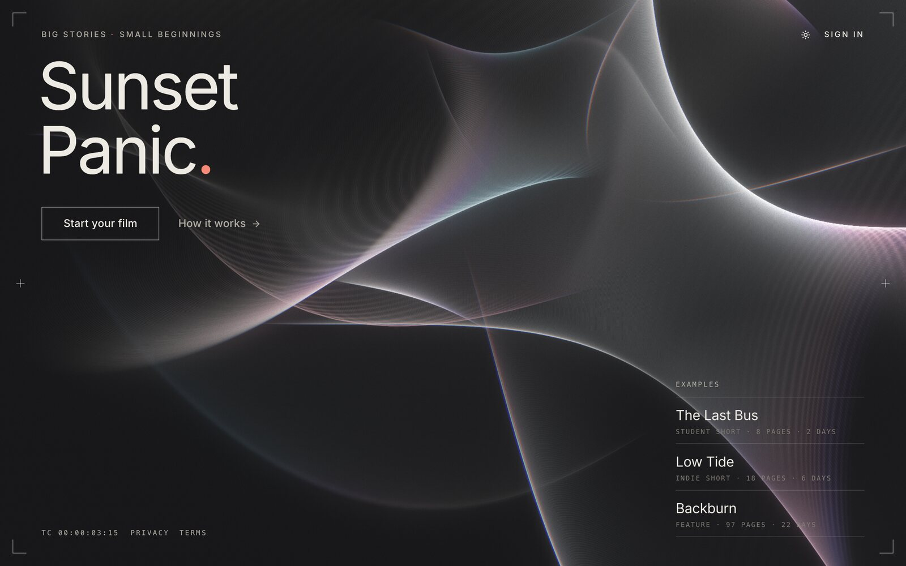
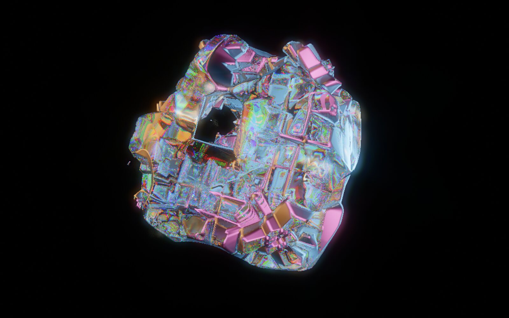
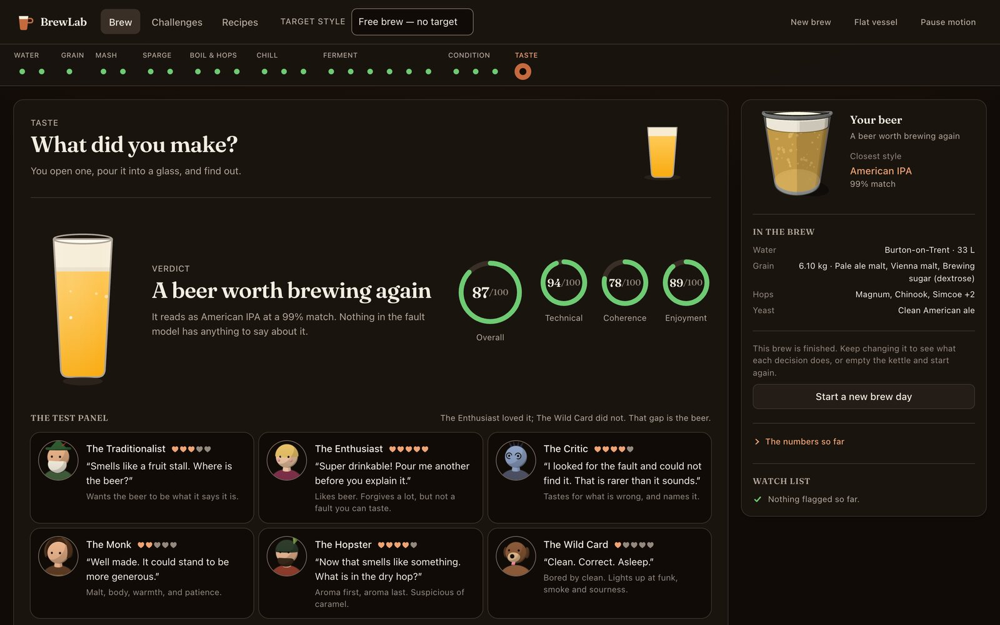
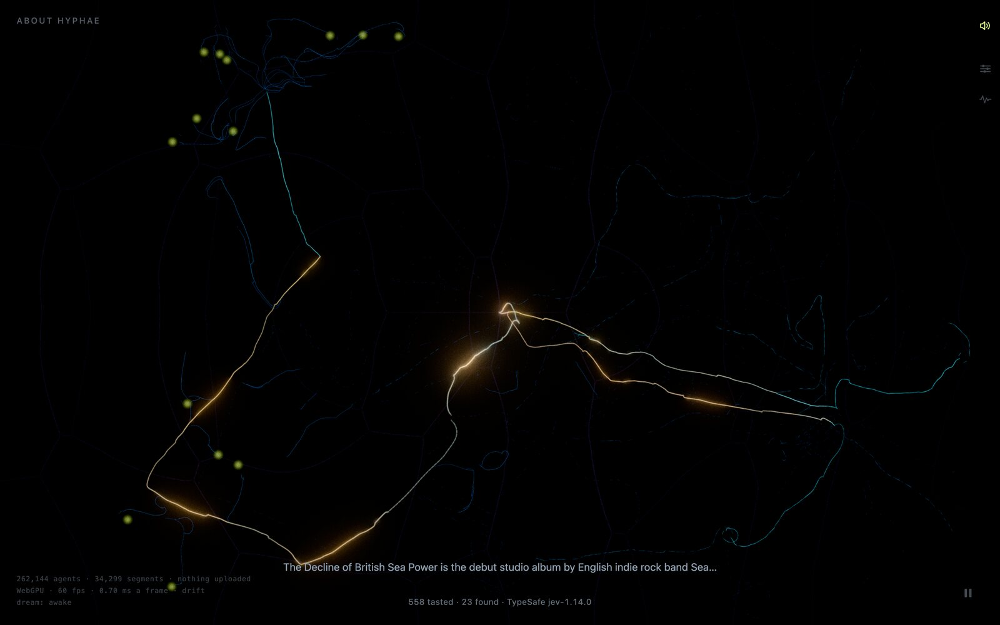
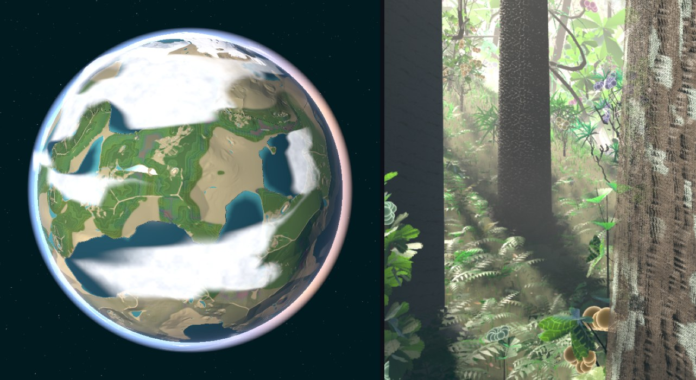
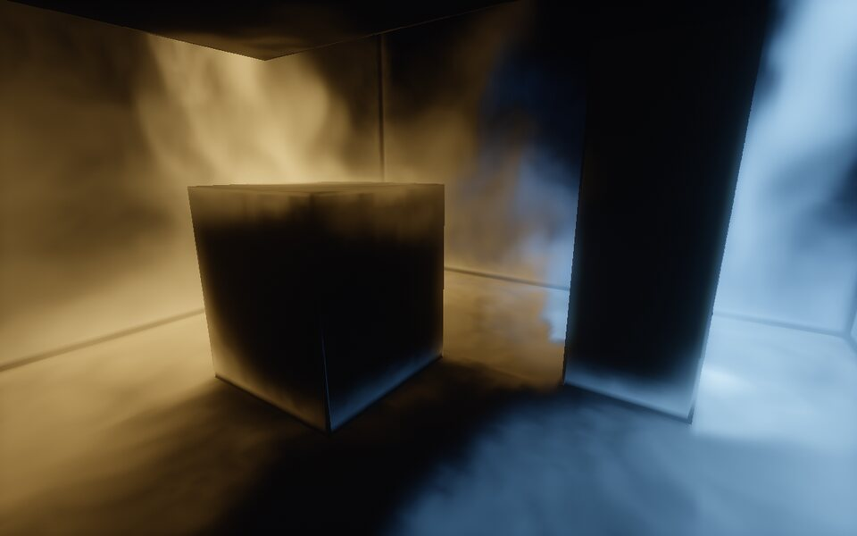
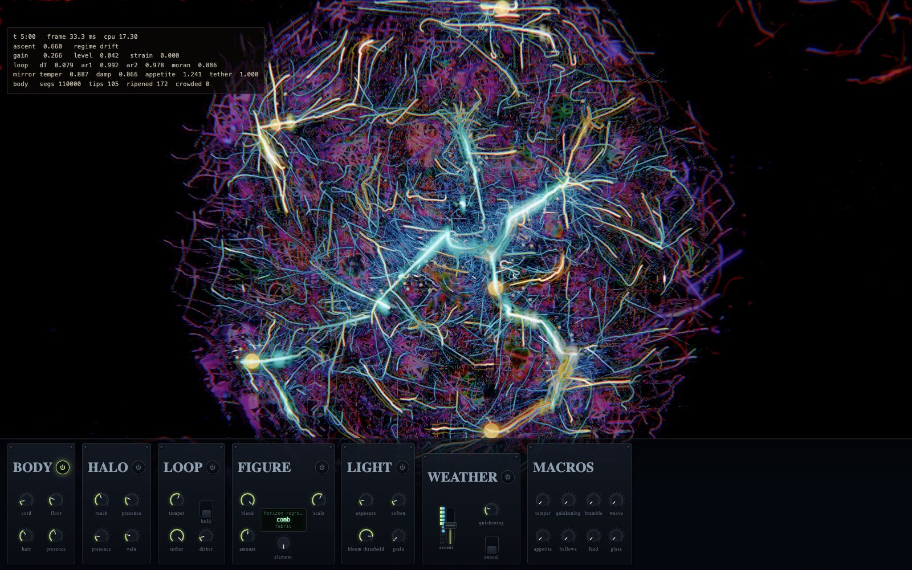
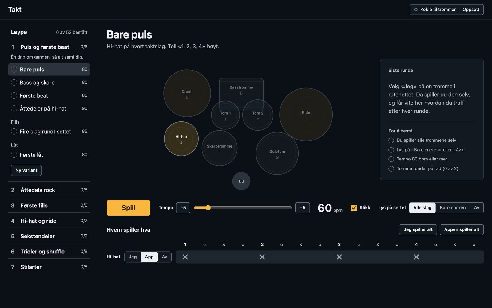

## Morten Brandanger

I build software professionally. This is mostly where the side projects end up.

They tend to start with something I'm curious about — climbing, music, AI, beer —
and turn into small experiments, tools or things I simply wanted to exist.

### Things you can open

**Sunset Panic** · [sunsetpanic.com](https://sunsetpanic.com) 
Plan, schedule and budget a film in one
place. Script, breakdown, stripboard, call sheets and budget share one data model, and
before a change is saved it shows you everything that change touches. *(Beta.)*

  

**Figur** · [figur-gamma.vercel.app](https://figur-gamma.vercel.app) 
A single figure in a black
nothing, living a life of its own. Form, light and sound are computed while you watch,
so no visit is the same. Needs a browser with WebGPU.

  

**BrewLab** · [brewexplained.com](https://brewexplained.com) 
A beer-brewing simulator that
explains what happens along the way. Change ingredients and process, and see how
those decisions affect the beer, and why. *(Open source, MIT:
[github.com/MortenBrandanger/brewlab](https://github.com/MortenBrandanger/brewlab))*

  

**MikroLLM** · [mikrollm.com](https://mikrollm.com) 
Train a tiny, real transformer
in your browser and watch it learn to predict. No API calls. *(Open source, MIT:
[github.com/MortenBrandanger/mikrollm](https://github.com/MortenBrandanger/mikrollm))*

  

**Hyphae** · [hyphae-beryl.vercel.app](https://hyphae-beryl.vercel.app) 
One persistent fungal
organism growing through literature, poetry and Wikipedia. It tastes every fragment that
drifts past it, a language model judges whether that fragment answers your question, and
the threads that find something thicken while the rest wither away. Click a sentence it
found and that sentence becomes the question.

  

**coilsplit** · [coilsplit.com](https://coilsplit.com) 
Guitar wiring diagrams you can actually
build. Generated from the circuit rather than drawn by hand: every switch position
analysed for phase and hum-cancelling, pickup colour codes translated between
brands, and a troubleshooter that works out what you mis-soldered from what you hear.

  

**Craggo** · [craggo.no](https://craggo.no) 
A simple climbing log for recording routes,
following friends and seeing progress over time.

  

**DreamDAW** · [dreamdaw.vercel.app](https://dreamdaw.vercel.app) 
An experiment in writing songs
together with an AI agent.

  

**Spore** · [spore-two.vercel.app](https://spore-two.vercel.app) 
The engine of Hyphae with the
language model taken out: a slime-mould swarm of 262,000 agents and a video feedback
loop you can drag around. Needs a browser with WebGPU.

  

### In the workshop

*Private for now.*

**Lurk** 
A small rendering engine, written from scratch in Metal, that lets one
living creature move into your room through an iPhone camera. It takes its light from
the room, casts soft shadows onto real surfaces measured by LiDAR, grows fur, keeps its
feet planted with inverse kinematics, leaps onto the table, hides behind your coffee
cup — and closes its eyes when you pet it.

**Svart skog** 
A small planet that keeps on living. Simulation first, headless and
measurable, on an engine of its own in C++23, Slang and Metal 4.

  

**Blekk** 
A horror game of light and shadow with nothing made by hand. You walk a
maze with a lantern full of light that flows, and something in the dark drinks it.
The rooms grow, and the sound is made by whatever is happening.

  

**psychoziser** 
An audiovisual instrument in the browser: an analogue-style panel
where you shape a psychedelic image and its sound by hand. A control panel you get
good at without ever quite figuring out.

  

**Takt** 
A practice tool for a beginner on electronic drums. It plays the whole
groove while you work on one limb, listens over MIDI, and tells you afterwards in
plain words whether you rush, drag or are just uneven. No points, no streaks.

  

**Leadsheet** 
A local MCP server where your own LLM writes the song skeleton, and
hands you a MIDI file that Logic Pro turns into a chord track and a band.

**Grevlingrunden** 
A spontaneous pub crawl. One button, no choices: the app picks
the next place, with a taste for the ones you haven't been to.
